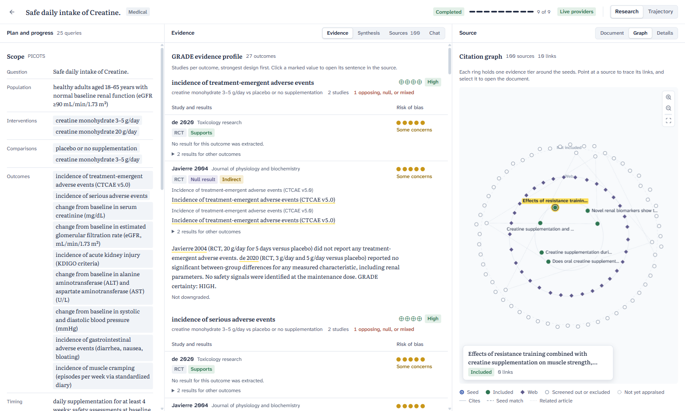
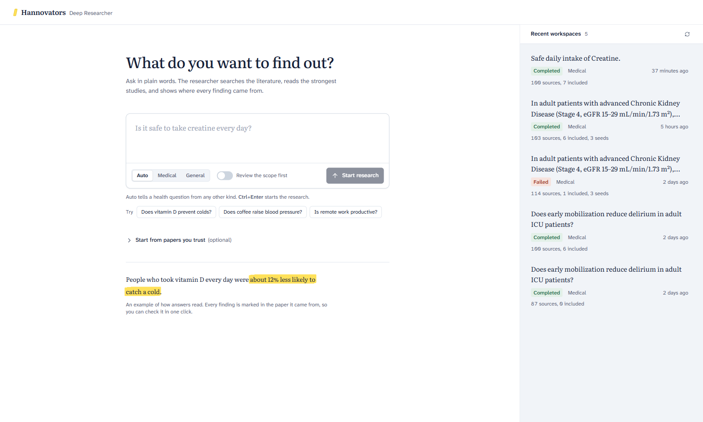
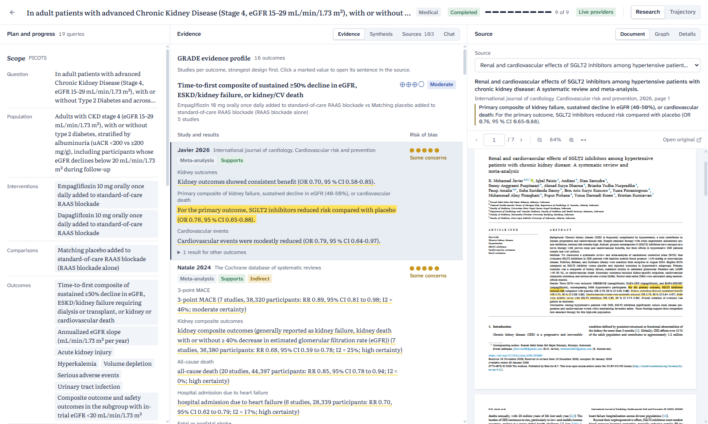
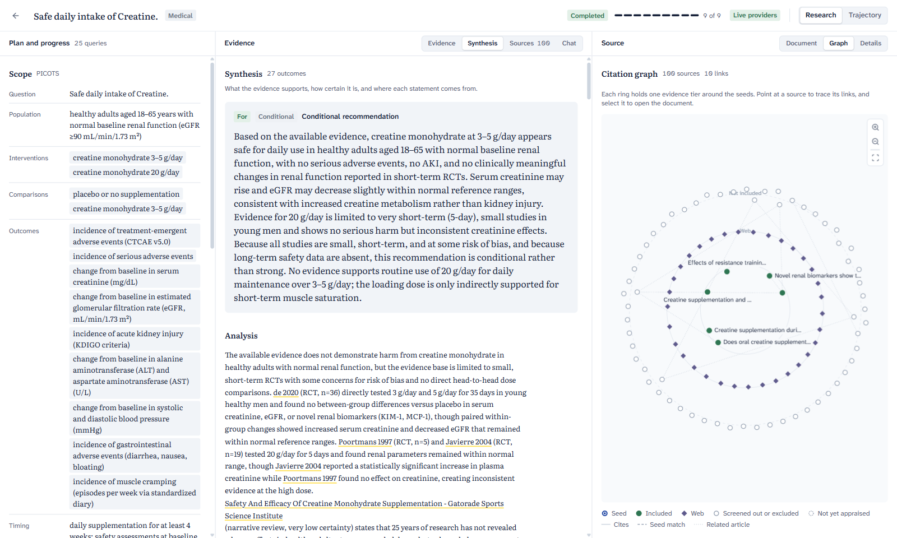
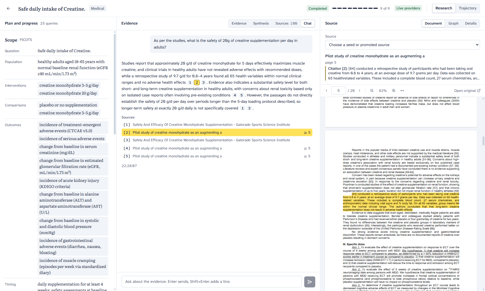
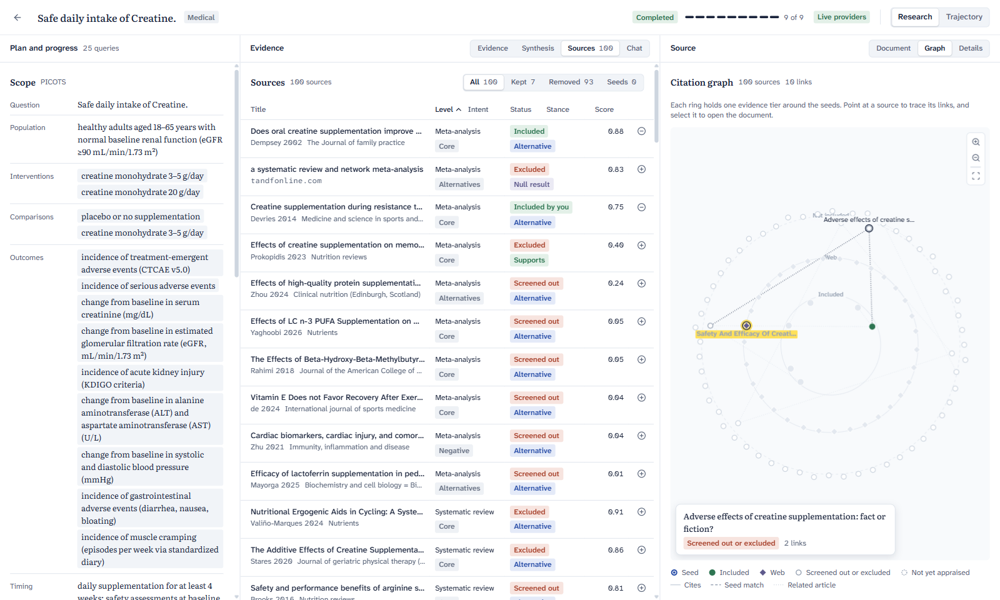
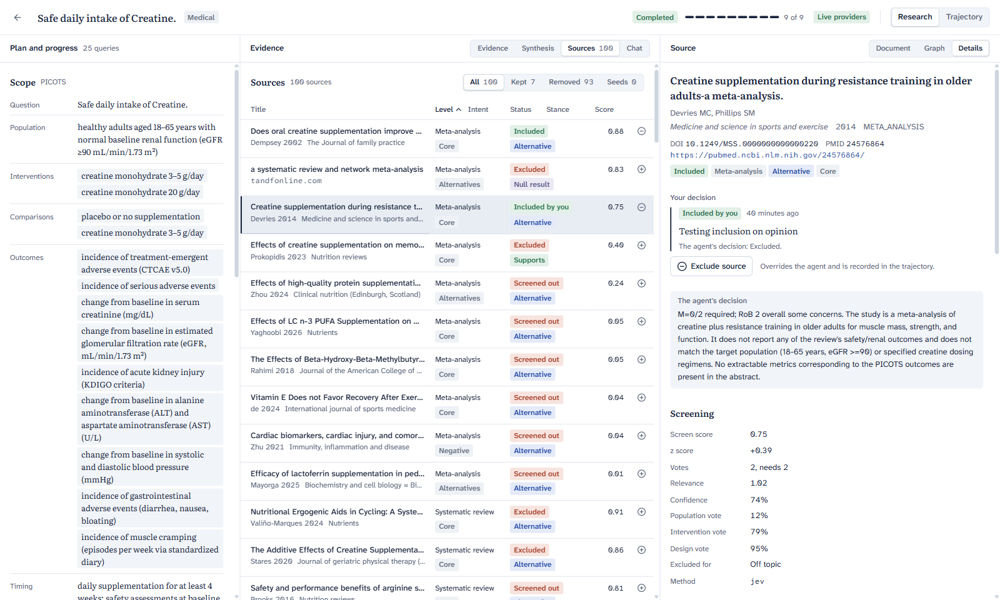
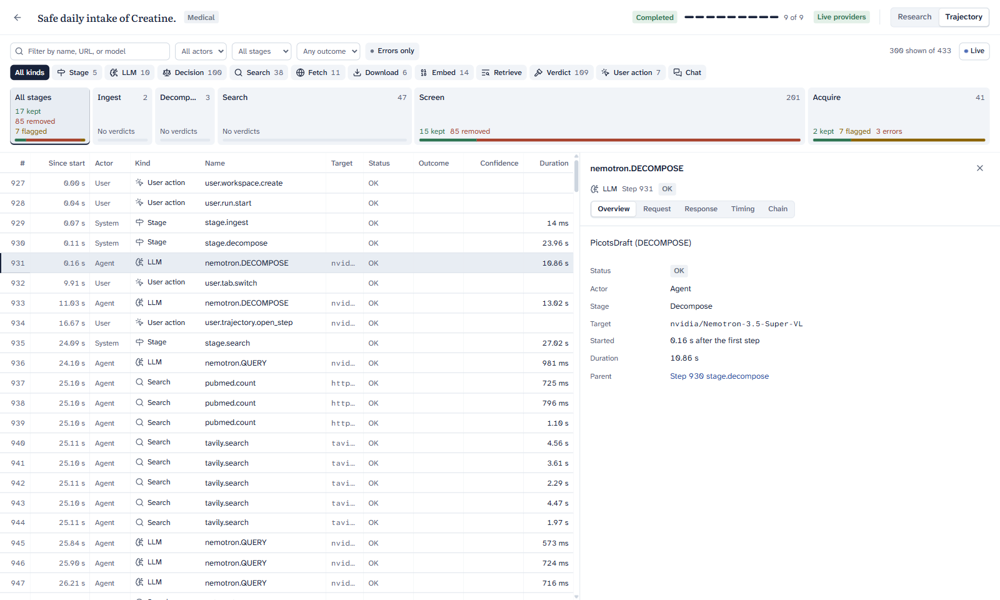

# Hannovators Deep Researcher

A medical deep-research workbench with full traceability. Ask a clinical question, and the agent searches the
literature, screens and appraises the studies, and writes a GRADE-style synthesis. Every finding, citation, and chat
answer opens the exact highlighted sentence in its source PDF, and every model call, search, and decision is on record.



> **Status: prototype.** We built this project during a hackathon. It is still in development as a
> personal project, so expect rough edges, breaking changes, and missing features. Do not use it for clinical
> decisions.

## About the project

Hannovators Deep Researcher was our project for the **Nebius x NVIDIA GTC Berlin 2026 Hackathon**, in the
**medical deep researcher** track.

We wanted a tool between [NotebookLM](https://notebooklm.google) and [Obsidian](https://obsidian.md):

- **Like NotebookLM**, answers stay grounded in a set of sources, and you can ask questions about them.
- **Like Obsidian**, the research becomes a workspace that you own and explore, with a graph of how the sources link.
- **Like [DeepSeek Harness](https://github.com/deepseek-ai/deepseek-harness)**, traceability is part of the design,
  not a log added later. The Trajectory view records every prompt, search, download, verdict, and user action, so you
  can audit how each conclusion came to be.

The medical workflow and the layout come from the npj Digital Medicine article
[*Streamlining evidence based clinical recommendations with large language models*](https://www.nature.com/articles/s41746-025-02273-y)
(Li et al., 2025). The article describes Quicker, a system that follows the five phases of clinical guideline
development: question decomposition, literature search, study selection, evidence assessment, and recommendation
formulation. Quicker also lets clinicians review and correct the intermediate results of each phase. We kept that
structure: the pipeline stages map to the same phases, the screen shows every phase side by side, and the researcher
can override the agent at any point.

## Features

### Ask a question in plain words

Start from a question. Choose Auto, Medical, or General mode, and optionally add seed papers (PDFs, PubMed IDs, DOIs,
or links) that the search starts from and reads in full.



### A GRADE evidence profile where every number is traceable

The agent decomposes the question into PICOTS, searches PubMed, Europe PMC, and the web, screens the hits, and
appraises the strongest studies with RoB 2. The evidence profile lists the studies per outcome. Click a marked value to
open its sentence, highlighted, in the source PDF.



### Synthesis and recommendation

The synthesis gives a recommendation with its direction and strength, and an analysis that cites each source. It also
names the strongest opposing or null evidence, not only the evidence that supports the answer.



### Chat with citations to the page

Ask follow-up questions about the evidence. Each answer cites its passages, and a citation opens the page with the
supporting text highlighted.



### Citation graph

The graph puts the seeds at the center and one ring around them for each evidence tier: included, web, and not
included. Point at a source to trace its links, and select it to open the document.



### Researcher decisions

Include a source that the agent dropped, or exclude one that it kept, with an optional reason. The agent's original
decision stays visible, and the decision goes into the trajectory. **Re-synthesize** then appraises the new sources
and updates the synthesis.



### Trajectory: the full audit trail

The Trajectory tab works like the network tab of a browser. It lists every step of the run with its actor, kind,
target, outcome, confidence, and duration. Open a step to see its request, response, timing, and parent steps.



## How it works

| Stage | What it does | Quicker phase |
| :--- | :--- | :--- |
| Ingest | Reads the seed PDFs and resolves seed references. | |
| Decompose | Turns the question into a PICOTS scope (Medical) or entities and claims (General). You can review it before the search. | Question decomposition |
| Search | Runs core, negative, alternative, and safety queries on PubMed, Europe PMC, and the web. | Literature search |
| Screen | Scores each hit on population, intervention, and design, and keeps the top candidates. | Study selection |
| Acquire | Downloads open-access full text, splits it into passages, and embeds them. | Study selection |
| Appraise | Grades each study (M-score, RoB 2, evidence level, stance) and extracts its claims with quotes. | Evidence assessment |
| Synthesize | Writes the GRADE profile, the analysis, and the recommendation. | Recommendation formulation |
| Highlight | Finds each quote in its PDF and draws the highlight. | |
| Compose | Picks the views that suit the domain and the data. | |

### Tech stack

- **Models:** NVIDIA Nemotron 3.5 Super VL on [Nebius Token Factory](https://nebius.com) for the agent, Qwen3
  Embedding 8B for embeddings, and Jev System One (Command Code) for screening and highlight decisions.
- **Search:** PubMed (NCBI E-utilities), Europe PMC, and Tavily for web search and deep research.
- **Backend:** Python 3.12, FastAPI, SQLite with SQLAlchemy and Alembic, and PyMuPDF for PDF work.
- **Frontend:** React 19, Vite, Tailwind CSS 4, shadcn/ui, pdf.js, and react-force-graph.

## Installation

### Prerequisites

- [uv](https://docs.astral.sh/uv/getting-started/installation/). If Python 3.12 or 3.13 is not available, uv installs it.
- [Node.js](https://nodejs.org) 24. The `.node-version` file gives the exact version.
- pnpm 11. Corepack, which comes with Node.js, gives the version in `frontend/package.json`.
- API keys for a live run:
  - `NEBIUS_API_KEY` for the agent model and the embeddings.
  - `JEV_API_KEY` for Jev System One through Command Code.
  - `TAVILY_API_KEY` for web search.
  - `NCBI_API_KEY` and `NCBI_EMAIL` (optional) to raise the PubMed rate limit.

You can run the full app without keys in offline mode (see [Launch](#launch)).

### 1. Get the code

```sh
git clone https://github.com/sharathnirmala16/hannovators-deep-researcher.git
cd hannovators-deep-researcher
```

### 2. Configure the environment

Copy the example file:

```sh
cp .env.example .env            # macOS and Linux
Copy-Item .env.example .env     # Windows PowerShell
```

Open `.env` and set these values:

```dotenv
API_PORT=8001
VITE_PORT=5174
NEBIUS_API_KEY=...
JEV_API_KEY=...
TAVILY_API_KEY=...
```

The ports have no default values. If a port is missing, the API and the dev server stop with an error.

### 3. Install the backend

From the repository root:

```sh
uv sync --locked
uv run alembic upgrade head
```

The second command creates the SQLite database in `data/hannovators.db`.

### 4. Install the frontend

From `frontend/`:

```sh
corepack enable
pnpm install --frozen-lockfile
```

## Launch

Use two terminals.

1. Start the API from the repository root:

   ```sh
   uv run hdr-api
   ```

2. Start the web app from `frontend/`:

   ```sh
   pnpm dev
   ```

3. Open `http://localhost:5174` (the value of `VITE_PORT`).

The dev server sends `/api` and `/files` requests to the API on `API_PORT`. After you change the backend code,
restart `uv run hdr-api`. The API does not reload by itself.

### Offline mode

To run without API keys, set `PROVIDER_MODE=fake` in `.env`. Then every provider uses the deterministic fakes in
`src/hannovators_deep_researcher/adapters/fake/`. With `PROVIDER_MODE=real`, a provider without a key also uses its
fake, and the API writes a warning. `GET /api/health/providers` shows which providers are real.

### Frontend only

To see the UI with recorded data and no backend, start the dev server with `VITE_USE_FIXTURES=1`. The dev server
still reads `VITE_PORT` and `API_PORT` from `.env`.

```sh
VITE_USE_FIXTURES=1 pnpm dev               # macOS and Linux
$env:VITE_USE_FIXTURES="1"; pnpm dev       # Windows PowerShell
```

## Development

### Structure

- `src/hannovators_deep_researcher/`: Python packages for models, configuration, services, adapters, infrastructure,
  persistence, and routers.
- `tests/`: unit, integration, end-to-end, and live tests.
- `frontend/src/`: app composition, features, domains, shared UI primitives, and test helpers.
- `data/`: the local SQLite database and the workspace files. Git ignores the runtime files.
- `docs/screenshots/`: the images in this README.
- `PLAN.md`: the architecture, the API contract, and the design system.
- `.agents/skills/`: architecture, quality, and test conventions for coding agents.

### Checks

From the repository root:

```sh
uv run ruff format --check
uv run ruff check
uv run mypy
uv run pytest
uv build
```

From `frontend/`:

```sh
pnpm check
pnpm build
pnpm test
```

`uv run pytest` skips the tests marked `live`. To run the offline end-to-end tests, use
`uv run pytest -m "e2e and not live"`. To run the provider checks and the live end-to-end tests in
`tests/e2e/test_live_*.py`, use `uv run pytest -m live`. Each live test skips when its API key is missing. Live runs
take minutes and use provider credit.

### Database

The default database is `data/hannovators.db`. To use a different file, set `DATABASE_URL` in `.env`.

To make a schema change, create a revision, review it, and then apply it:

```sh
uv run alembic revision --autogenerate -m "describe change"
uv run alembic upgrade head
```

Revisions `0002` to `0004` hold the product schema. Source files are in
`data/workspaces/<workspace_id>/sources/<source_id>/` (`raw.pdf`, `snapshot.md`, `highlighted.pdf`).

### Worktrees

Parallel agents work in separate Git worktrees, each with its own ports, `.env`, `.venv`, and database. From the
repository root on Windows:

```bat
scripts\windows\create_worktree.bat <branch> <slot 1-9> [full|backend|frontend|bare]
scripts\windows\delete_worktree.bat <slot|branch> [--force] [--keep-branch]
```

`AGENTS.md` lists the ports for each slot.

### UI

The visual system ("annotated paper") is in `PLAN.md` section 10. It uses only solid hex color tokens, Atkinson
Hyperlegible Next and Mono for the interface, and Literata for reading text. The fonts come from `@fontsource-variable`
packages, so the app works offline. UI primitives come from shadcn and live in `frontend/src/shared/ui/`. To add a
primitive, use the same shadcn CLI version:

```sh
pnpm dlx shadcn@4.21.4 add <component>
```

## License

This project is licensed under the [GNU Affero General Public License v3.0 or later](LICENSE) (AGPL-3.0-or-later).

The backend uses [PyMuPDF](https://pymupdf.readthedocs.io), which is available under the AGPL-3.0 or a commercial
license from Artifex. Because of this, the project uses the AGPL-3.0 too. If you run a changed version of this
software as a network service, the AGPL requires you to offer its source code to the users of that service.

Third-party packages keep their own licenses. The bundled fonts (Atkinson Hyperlegible and Literata) use the SIL Open
Font License 1.1.

## Acknowledgements

- Nebius and NVIDIA, for the hackathon and the models.
- [Tavily](https://tavily.com), for the AI search API credits.
- [Qwen](https://qwenlm.github.io), for the Qwen3 Embedding model.
- [Cognition Labs](https://cognition.ai), for the Devin Max plan that we used during the hackathon.
- Li et al., for the Quicker workflow in
  [npj Digital Medicine (2025)](https://www.nature.com/articles/s41746-025-02273-y).
- DeepSeek Harness, NotebookLM, and Obsidian, for the ideas that shaped this tool.
